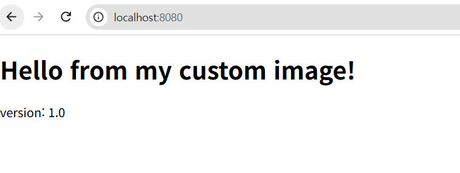
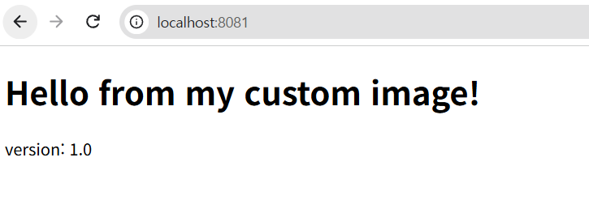
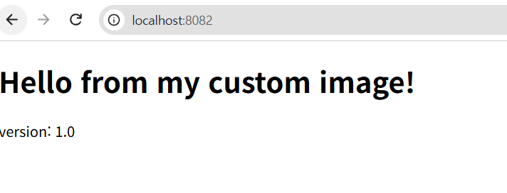
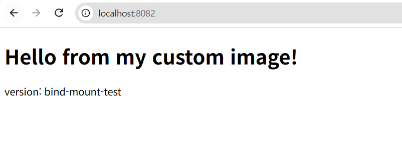
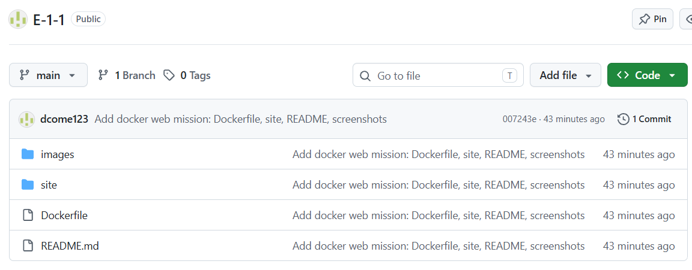
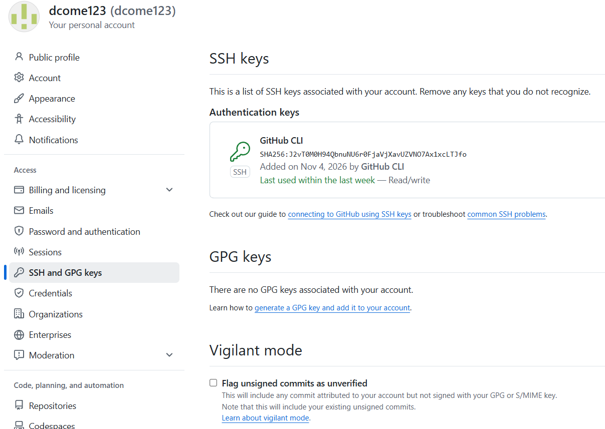
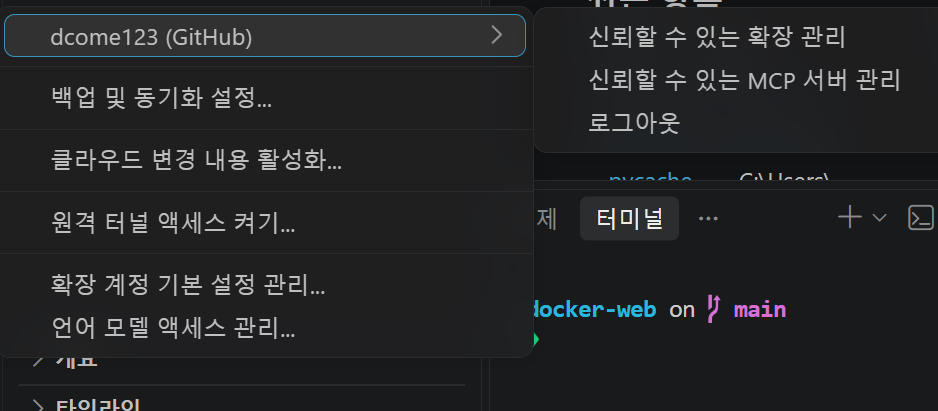
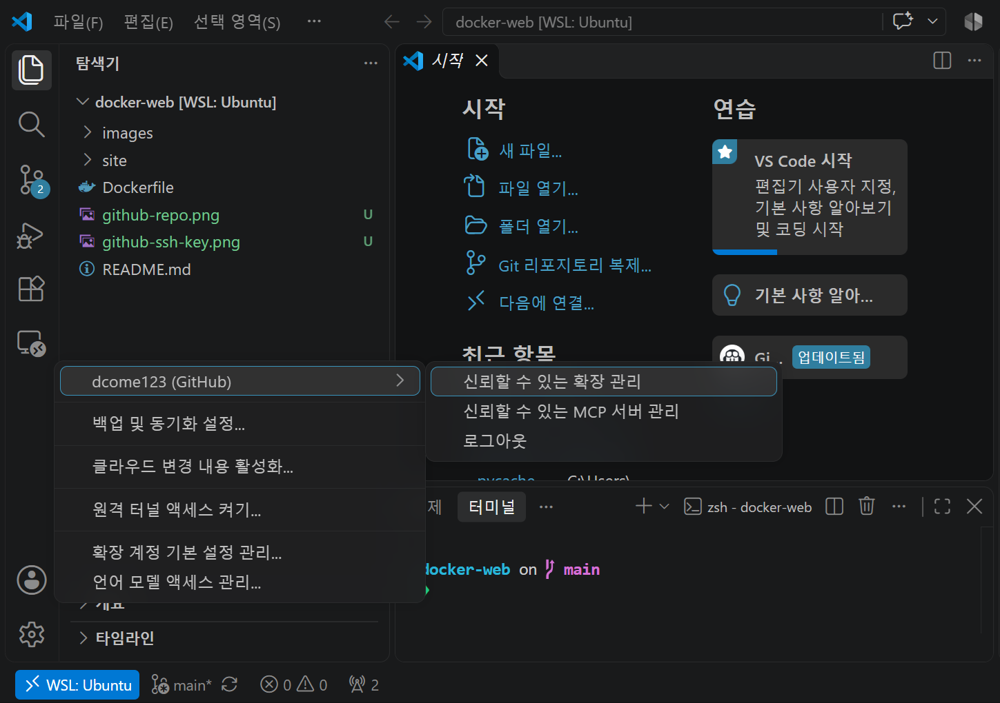

# 개발 워크스테이션 구축 (터미널 · Docker · Git)

## 1. 프로젝트 개요

개발 환경을 "내 컴퓨터에서만 돌아가는" 상태가 아니라, 누구나 같은 방식으로 실행·배포·디버깅할 수 있도록 구성하는 미션이다.
터미널(CLI)로 작업 디렉토리와 권한을 다루고, Docker로 컨테이너를 실행·관리하며, Dockerfile로 웹 서버 이미지를 만들고, 포트 매핑·바인드 마운트·볼륨을 직접 검증한다. 마지막으로 Git/GitHub를 설정한다.

## 2. 실행 환경

| 항목 | 내용 |
|---|---|
| OS | Windows + WSL2 (Linux 커널 6.18.54.1-microsoft-standard-WSL2) |
| Shell / Terminal | zsh (`/usr/bin/zsh`), WSL2 터미널 |
| Docker | 29.9.2 (Docker Desktop 4.98.0, WSL2 백엔드) |
| Git | 2.53.0 |

```bash
$ docker --version
Docker version 29.9.2, build a82e528
$ git --version
git version 2.53.0
$ echo $SHELL
/usr/bin/zsh
$ docker info
Client:
 Version:    29.9.2
 Context:    default
 Debug Mode: false
 Plugins:
  ...(Docker Desktop 기본 플러그인 목록 생략)...

Server:
 Containers: 5
  Running: 3
  Paused: 0
  Stopped: 2
 Images: 4
 Server Version: 29.9.2
 Storage Driver: overlayfs
 Cgroup Driver: cgroupfs
 Cgroup Version: 2
 Kernel Version: 6.18.54.1-microsoft-standard-WSL2
 Operating System: Docker Desktop
 OSType: linux
 Architecture: x86_64
 CPUs: 12
 Total Memory: 2.764GiB
 Name: docker-desktop
 ID: (마스킹)
 Docker Root Dir: /var/lib/docker
 ...(이하 프록시/레지스트리 설정 생략)...
```

- 관찰: `docker info`가 Client와 Server 정보를 모두 출력하므로 Docker 데몬이 정상 동작 중이다. (`Containers: 5`, `Running: 3`)
> 참고: 서울캠퍼스 안내는 macOS의 OrbStack 기준이다. 이 실습은 Windows의 Docker Desktop(WSL2 백엔드)에서 수행했으며 `docker` 명령은 동일하게 사용했다.

> 참고: 이 환경의 `ls`는 `eza` 계열로 보이는 출력 형식(`.rw-r--r--`)을 사용한다. 일반 `ls -l`의 `-rw-r--r--`와 같은 의미다. (`type ls`로 확인 가능)
> 개인정보 보호를 위해 로그의 사용자명은 `user`로 치환했다.

## 3. 수행 체크리스트

- [x] 터미널 기본 조작 (pwd, ls -la, cd, mkdir, touch, cp, mv, rm, cat)
- [x] 절대 경로 / 상대 경로 실습
- [x] 권한 변경 실습 (파일 1개, 디렉토리 1개)
- [x] Docker 설치/점검 (`docker --version`, `docker info`)
- [x] 이미지 다운로드 (`docker pull`)
- [x] hello-world 실행 (실행 기록 확인, 아래 4-4 참고)
- [x] ubuntu 컨테이너 실행 및 내부 진입
- [x] 컨테이너 중지/시작 (`docker stop`, `docker start`)
- [x] 컨테이너 종료/유지 차이 관찰 (run -it / exec / attach)
- [x] Dockerfile 기반 커스텀 이미지 (nginx:alpine)
- [x] 빌드 로그 (`docker build` 출력)
- [x] 포트 매핑 접속 2회 (8080, 8081)
- [x] 운영 명령 (images, ps, logs, stats, inspect)
- [x] 바인드 마운트 반영 (명령/출력 비교)
- [x] 바인드 마운트 스크린샷
- [x] Docker 볼륨 영속성
- [x] 트러블슈팅 2건 이상 (6건 기록)
- [x] Git 사용자 정보 / 기본 브랜치 설정
- [x] GitHub CLI(gh) 로그인 및 저장소 푸시 (SSH)
- [x] VSCode GitHub 로그인 및 WSL 저장소 폴더 연동 (트러블슈팅 6 참고)

### 터미널 기본 조작

| 명령어 | 하는 일 |
|---|---|
| pwd | 현재 내 위치 출력 |
| ls -la | 파일 목록 + 숨김파일 + 상세정보 표시 |
| cd | 폴더 이동 |
| mkdir | 폴더 생성 |
| touch | 빈 파일 생성 |
| cp / mv / rm | 복사 / 이동 / 삭제 |
| cat | 파일 내용 출력 |


### 검증 방법과 증거 위치

| 항목 | 확인에 사용한 명령 | 확인한 내용 | 증거 위치 |
|---|---|---|---|
| 터미널 기본 조작 | `pwd`, `ls -la`, `cd`, `mkdir`, `touch`, `cp`, `mv`, `rm`, `cat` | 위치 확인, 생성/복사/이동/삭제, 내용 확인 | [4-1](#4-1-터미널-기본-조작) |
| 절대/상대 경로 | `cd`, `pwd` | 세 방식 모두 같은 위치에 도착 | [4-2](#4-2-절대-경로와-상대-경로) |
| 권한 | `ls -l`, `chmod` | 600/700 변경 전/후 비교 | [4-3](#4-3-권한-실습) |
| Docker 점검 | `docker --version`, `docker info` | 버전, 데몬 동작 | [2. 실행 환경](#2-실행-환경) |
| 컨테이너 실행 | `docker run`, `exec`, `attach`, `stop`, `start` | 종료/유지 차이 | [4-4](#4-4-docker-기본-운영과-컨테이너-실행) |
| 커스텀 이미지 | `docker build`, `docker run` | 빌드/실행 성공 | [4-5](#4-5-dockerfile-기반-커스텀-이미지) |
| 포트 매핑 | `docker run -p`, `curl`, 브라우저 | 8080, 8081 접속 | [4-6](#4-6-포트-매핑-2회) |
| 운영 | `docker logs`, `docker stats` | 요청 로그, 자원 사용량 | [4-7](#4-7-운영-명령-logs와-stats) |
| 바인드 마운트 | `-v 경로:경로`, `sed`, `curl` | 재빌드 없이 변경 반영 | [4-8](#4-8-바인드-마운트) |
| 볼륨 영속성 | `docker volume`, `docker rm -f` | 삭제 후에도 데이터 유지 | [4-9](#4-9-docker-볼륨-영속성) |
| Git/GitHub | `git config --list`, VSCode 로그인 | 설정, 연동 | [4-10](#4-10-git-설정-및-github-연동) |
| 트러블슈팅 | 각 항목 참고 | 문제 → 가설 → 확인 → 해결 | [5](#5-트러블슈팅) |

## 4. 수행 로그와 검증

### 4-1. 터미널 기본 조작

```bash
$ pwd
/home/user/codyssey/docker-web
$ mkdir -p ~/codyssey/practice
$ cd ~/codyssey/practice
$ pwd
/home/user/codyssey/practice
$ touch empty.txt
$ echo "hello terminal" > memo.txt
$ ls -la
.rw-r--r--  0 user  4 Nov 15:54  empty.txt
.rw-r--r-- 15 user  4 Nov 15:54  memo.txt
$ cat memo.txt
hello terminal
$ cp memo.txt memo_copy.txt
$ mv memo_copy.txt renamed.txt
$ mkdir testdir
$ mv renamed.txt testdir/
$ ls -la testdir
.rw-r--r-- 15 user  4 Nov 15:54  renamed.txt
$ rm testdir/renamed.txt
$ rmdir testdir
$ ls -la
.rw-r--r--  0 user  4 Nov 15:54  empty.txt
.rw-r--r-- 15 user  4 Nov 15:54  memo.txt
$ cd ..
$ pwd
/home/user/codyssey
```

> 연습용 파일은 `~/codyssey/practice`에서 실습했고 저장소에는 포함하지 않았다. 모든 명령과 출력은 이 README에 기록했다.

| 요구 항목 | 사용한 명령 |
|---|---|
| 현재 위치 확인 | `pwd` |
| 목록 확인(숨김 포함) | `ls -la` |
| 이동 | `cd` |
| 생성 | `mkdir`, `touch` |
| 복사 | `cp` |
| 이동/이름변경 | `mv` |
| 삭제 | `rm`, `rmdir` |
| 파일 내용 확인 | `cat` |
| 빈 파일 생성 | `touch empty.txt` |

### 4-2. 절대 경로와 상대 경로

```bash
$ cd /home/user/codyssey/practice
$ pwd
/home/user/codyssey/practice
$ cd ..
$ cd practice
$ pwd
/home/user/codyssey/practice
$ cd ~
$ cd codyssey/practice
$ pwd
/home/user/codyssey/practice
```

| 방식 | 명령 | 특징 |
|---|---|---|
| 절대 경로 | `cd /home/user/codyssey/practice` | `/`(루트)부터 시작. 현재 위치와 무관하게 항상 같은 곳 |
| 상대 경로 | `cd ..` → `cd practice` | 현재 위치 기준. 출발점이 다르면 도착지도 달라짐 |
| 홈 기준 상대 경로 | `cd ~` → `cd codyssey/practice` | 홈에서 출발하므로 같은 곳에 도착 |

- 관찰: 세 방식 모두 같은 위치에 도착했다.
- 해석: 절대 경로는 전체 주소, 상대 경로는 "지금 위치에서의 길 안내"다. 예를 들어 `codyssey` 폴더 안에서는 `cd practice`가 되지만 다른 곳에서는 실패한다.

숨김 파일 확인:

```bash
$ touch .hidden_test
$ ls -la
drwxr-xr-x  - user  4 Nov 15:55  perm_dir
.rw-r--r--  0 user  4 Nov 15:57  .hidden_test
.rw-r--r--  0 user  4 Nov 15:54  empty.txt
.rw-r--r-- 15 user  4 Nov 15:54  memo.txt
.rw-r--r--  0 user  4 Nov 15:55  perm_test.txt
```

- 관찰: 이름이 `.`으로 시작하는 파일은 `-a` 옵션(`ls -la`)에서 보인다.

### 4-3. 권한 실습

```bash
$ cd ~/codyssey/practice
$ touch perm_test.txt
$ mkdir perm_dir
$ ls -l perm_test.txt
.rw-r--r-- 0 user  4 Nov 15:55  perm_test.txt
$ ls -ld perm_dir
drwxr-xr-x - user  4 Nov 15:55  perm_dir
$ chmod 600 perm_test.txt
$ chmod 700 perm_dir
$ ls -l perm_test.txt
.rw------- 0 user  4 Nov 15:55  perm_test.txt
$ ls -ld perm_dir
drwx------ - user  4 Nov 15:55  perm_dir
$ chmod 755 perm_dir
$ chmod 644 perm_test.txt
$ ls -l perm_test.txt
.rw-r--r-- 0 user  4 Nov 15:55  perm_test.txt
$ ls -ld perm_dir
drwxr-xr-x - user  4 Nov 15:55  perm_dir
```

| 단계 | 파일 `perm_test.txt` | 디렉토리 `perm_dir` |
|---|---|---|
| 변경 전(기본값) | `rw-r--r--` (644) | `rwxr-xr-x` (755) |
| 변경 후 | `rw-------` (600) | `rwx------` (700) |
| 복구 후 | `rw-r--r--` (644) | `rwxr-xr-x` (755) |

**권한 표기 규칙**

- r(읽기)=4, w(쓰기)=2, x(실행)=1이고, 합계를 소유자 / 그룹 / 기타 순서로 한 자리씩 쓴다.
- `755` = 소유자 rwx(7), 그룹 r-x(5), 기타 r-x(5)
- `644` = 소유자 rw-(6), 그룹 r--(4), 기타 r--(4)
- 디렉토리에서 `x`는 "그 안으로 들어갈 수 있는 권한"이다.

### 4-4. Docker 기본 운영과 컨테이너 실행

hello-world와 ubuntu 컨테이너 실행 기록 (`docker ps -a` 일부):

```bash
c64ce12ff1b1   hello-world   "/hello"   17 hours ago     Exited (0) 17 hours ago     recursing_wozniak
7b3dfc9d0fe4   ubuntu        "bash"     58 minutes ago   Up 55 minutes               reverent_feistel
```

```bash
$ docker run hello-world

Hello from Docker!
This message shows that your installation appears to be working correctly.

To generate this message, Docker took the following steps:
 1. The Docker client contacted the Docker daemon.
 2. The Docker daemon pulled the "hello-world" image from the Docker Hub.
    (amd64)
 3. The Docker daemon created a new container from that image which runs the
    executable that produces the output you are currently reading.
 4. The Docker daemon streamed that output to the Docker client, which sent it
    to your terminal.
...
```

- 관찰: `Hello from Docker!` 메시지가 출력되어 hello-world 실행에 성공했다.

#### 이미지 다운로드와 컨테이너 중지/시작

```bash
$ docker pull alpine:latest
latest: Pulling from library/alpine
Digest: sha256:be2656061b536c1883c4034790e21d0a09c5aaaf51968b89368a3c0371ea2c9a
Status: Image is up to date for alpine:latest
docker.io/library/alpine:latest
$ docker images
IMAGE                ID             DISK USAGE   CONTENT SIZE   EXTRA
alpine:latest        be2656061b53         13MB         3.94MB
hello-world:latest   c567b231f656       25.9kB         9.49kB    U
my-web:1.0           80910c3eebd0       93.6MB         26.3MB
ubuntu:latest        6a06111c3b0a        163MB         45.9MB    U
$ docker stop my-web-8081
my-web-8081
$ docker ps -a --filter name=my-web-8081
CONTAINER ID   IMAGE          COMMAND                  CREATED          STATUS                              PORTS     NAMES
aee344a75b26   4d47250fae46   "/docker-entrypoint.…"   50 minutes ago   Exited (0) Less than a second ago             my-web-8081
$ docker start my-web-8081
my-web-8081
$ docker ps --filter name=my-web-8081
CONTAINER ID   IMAGE          COMMAND                  CREATED          STATUS                            PORTS                                     NAMES
aee344a75b26   4d47250fae46   "/docker-entrypoint.…"   50 minutes ago   Up 3 seconds (health: starting)   0.0.0.0:8081->80/tcp, [::]:8081->80/tcp   my-web-8081
```

- 관찰 1: `docker pull`은 `alpine:latest`가 이미 로컬에 있어 `Image is up to date`로 끝났고, `docker images`에서 목록을 확인했다.
- 관찰 2: `docker stop` 후 STATUS가 `Exited (0)`, `docker start` 후 다시 `Up`이 되었고 포트 매핑(8081→80)도 유지되었다.
- 관찰 3: 재시작 직후에는 `health: starting`이며 잠시 뒤 `healthy`로 바뀐다.
- 참고: 아래 4-5에서 이미지를 다시 빌드해 `my-web:1.0`의 ID가 `4d47250fae46`에서 `80910c3eebd0`으로 바뀌었다. 기존 컨테이너는 이전 ID의 이미지로 계속 실행된다.

#### (1) docker run -it: exit 시 컨테이너 종료 여부

```bash
$ docker run -it --name ubuntu-run ubuntu bash
root@f4cf4e9fa4cd:/# echo hello && exit
hello
exit
$ docker ps -a --filter name=ubuntu-run
CONTAINER ID   IMAGE     COMMAND   CREATED          STATUS                              PORTS     NAMES
f4cf4e9fa4cd   ubuntu    "bash"    30 seconds ago   Exited (0) Less than a second ago             ubuntu-run
```

- 관찰: `exit` 후 STATUS가 `Exited (0)`
- 해석: `bash`가 메인 프로세스(PID 1)라서 bash가 끝나면 컨테이너도 종료된다.

#### (2) docker exec: exit 후에도 컨테이너 유지 여부

```bash
$ docker run -d --name ubuntu-keep ubuntu sleep infinity
37925c5b366ce5b0f643d8ca7888beec2c9594a0f1351aaf0f1e6d8b39726c01
$ docker exec -it ubuntu-keep bash
root@37925c5b366c:/# ls && exit
bin  boot  dev  etc  home  lib  lib64  media  mnt  opt  proc  root  run  sbin  srv  sys  tmp  usr  var
exit
$ docker ps --filter name=ubuntu-keep
CONTAINER ID   IMAGE     COMMAND            CREATED          STATUS          PORTS     NAMES
37925c5b366c   ubuntu    "sleep infinity"   13 seconds ago   Up 12 seconds             ubuntu-keep
```

- 관찰: `exec`로 들어간 bash를 `exit`해도 `Up` 유지
- 해석: 메인 프로세스는 `sleep infinity`이고 `exec`의 bash는 추가로 띄운 보조 프로세스다. 보조 프로세스가 끝나도 메인 프로세스는 계속 실행된다.

#### (3) docker attach: 분리(Ctrl+P, Ctrl+Q)와 종료(exit)의 차이

```bash
$ docker run -dit --name ubuntu-it ubuntu bash
00c2f45a810bdc0a8c63d293842401069fd640313b551d13486a6ce9a217152b
$ docker attach ubuntu-it
root@00c2f45a810b:/# docker ps --filter name=ubuntu-it
bash: docker: command not found
root@00c2f45a810b:/# (Ctrl+P, Ctrl+Q로 분리)
$ docker ps --filter name=ubuntu-it
CONTAINER ID   IMAGE     COMMAND   CREATED              STATUS              PORTS     NAMES
00c2f45a810b   ubuntu    "bash"    About a minute ago   Up About a minute             ubuntu-it
$ docker attach ubuntu-it
root@00c2f45a810b:/# exit
exit
$ docker ps -a --filter name=ubuntu-it
CONTAINER ID   IMAGE     COMMAND   CREATED              STATUS                       PORTS     NAMES
00c2f45a810b   ubuntu    "bash"    About a minute ago   Exited (127) 6 seconds ago             ubuntu-it
```

- 관찰 1: `Ctrl+P, Ctrl+Q`로 분리하면 `Up` 유지
- 관찰 2: attach 후 `exit`하면 메인 프로세스(bash)가 종료되어 `Exited`
- 관찰 3: 종료 코드가 127인 이유는 직전에 컨테이너 안에서 입력한 `docker ps`가 `command not found`(127)였고, bash가 마지막 명령의 종료 코드를 그대로 반환했기 때문이다.

#### 종합

| 방식 | 명령 | 빠져나온 뒤 상태 | 이유 |
|---|---|---|---|
| run -it | `docker run -it ubuntu bash` | Exited (0) | bash가 메인 프로세스 |
| exec | `docker exec -it ubuntu-keep bash` | Up 유지 | 메인은 `sleep infinity`, bash는 보조 프로세스 |
| attach + 분리 | `Ctrl+P, Ctrl+Q` | Up 유지 | 연결만 끊고 프로세스는 종료하지 않음 |
| attach + exit | `exit` | Exited | 메인 프로세스(bash) 종료 |

**결론: 컨테이너의 수명은 메인 프로세스(PID 1)의 수명과 같다.**

#### 컨테이너 정리

```bash
$ docker ps -a
CONTAINER ID   IMAGE         COMMAND            CREATED          STATUS                       PORTS     NAMES
00c2f45a810b   ubuntu        "bash"             6 minutes ago    Exited (127) 5 minutes ago             ubuntu-it
37925c5b366c   ubuntu        "sleep infinity"   7 minutes ago    Up 7 minutes                           ubuntu-keep
f4cf4e9fa4cd   ubuntu        "bash"             9 minutes ago    Exited (0) 9 minutes ago               ubuntu-run
7b3dfc9d0fe4   ubuntu        "bash"             58 minutes ago   Up 55 minutes                          reverent_feistel
c64ce12ff1b1   hello-world   "/hello"           17 hours ago     Exited (0) 17 hours ago                recursing_wozniak
$ docker rm -f ubuntu-run ubuntu-keep ubuntu-it
ubuntu-run
ubuntu-keep
ubuntu-it
$ docker ps -a
CONTAINER ID   IMAGE         COMMAND    CREATED          STATUS                    PORTS     NAMES
7b3dfc9d0fe4   ubuntu        "bash"     58 minutes ago   Up 55 minutes                       reverent_feistel
c64ce12ff1b1   hello-world   "/hello"   17 hours ago     Exited (0) 17 hours ago             recursing_wozniak
```

- 관찰: `docker rm -f`는 실행 중인 컨테이너(`ubuntu-keep`)도 강제로 중지하고 삭제한다.

### 4-5. Dockerfile 기반 커스텀 이미지

**선택한 방식**: (A) 웹 서버 베이스 이미지(`nginx:alpine`) + 정적 콘텐츠 교체

디렉토리 구성:

```
docker-web/
├── README.md
├── Dockerfile
├── site/
│   └── index.html
└── images/
    ├── port-8080.png
    ├── port-8081.png
    ├── bind-before.png
    ├── bind-after.png
    ├── github-repo.png
    ├── github-ssh-key.png
    ├── vscode-github.png
    └── vscode-workspace.png
```

`site/index.html`

```html
<!DOCTYPE html>
<html lang="ko">
<head><meta charset="UTF-8"><title>My Custom Nginx</title></head>
<body>
  <h1>Hello from my custom image!</h1>
  <p>version: 1.0</p>
</body>
</html>
```

`Dockerfile`

```dockerfile
FROM nginx:alpine

LABEL org.opencontainers.image.title="my-custom-nginx" \
      org.opencontainers.image.description="Codyssey mission 1 custom web server"

ENV APP_ENV=dev

COPY site/ /usr/share/nginx/html/

EXPOSE 80

HEALTHCHECK --interval=30s --timeout=3s --retries=3 \
  CMD wget -q --spider http://localhost/ || exit 1
```

**커스텀 포인트와 목적**

| 포인트 | 목적 |
|---|---|
| `FROM nginx:alpine` | 검증된 웹 서버 이미지를 가볍게 재사용 |
| `LABEL` | 이미지 메타데이터 명시 |
| `ENV APP_ENV=dev` | 설정을 코드와 분리 |
| `COPY site/` | 기본 페이지를 내 콘텐츠로 교체 |
| `EXPOSE 80` | 컨테이너가 사용하는 포트를 문서화 |
| `HEALTHCHECK` | 컨테이너 상태를 자동 점검 |

빌드 로그:

```bash
$ docker build --no-cache -t my-web:1.0 .
[+] Building 1.3s (7/7) FINISHED                                          docker:default
 => [internal] load build definition from Dockerfile                                0.0s
 => => transferring dockerfile: 366B                                                0.0s
 => [internal] load metadata for docker.io/library/nginx:alpine                     0.5s
 => [internal] load .dockerignore                                                   0.0s
 => => transferring context: 2B                                                     0.0s
 => [internal] load build context                                                   0.0s
 => => transferring context: 61B                                                    0.0s
 => CACHED [1/2] FROM docker.io/library/nginx:alpine@sha256:785835ea65db...         0.1s
 => [2/2] COPY site/ /usr/share/nginx/html/                                         0.1s
 => exporting to image                                                              0.3s
 => => naming to docker.io/library/my-web:1.0                                       0.0s
 => => unpacking to docker.io/library/my-web:1.0                                    0.0s
```

- 관찰: 빌드가 `FINISHED`로 성공했고, `COPY site/ /usr/share/nginx/html/` 단계가 실행되었다. 베이스 이미지 레이어(`nginx:alpine`)는 이미 받아 둔 것을 재사용했다(`CACHED`).
- 처음 빌드한 기록은 남기지 않아, 재빌드 결과를 기록했다. (출력은 가독성을 위해 일부 줄과 해시를 줄였다.)

### 4-6. 포트 매핑 2회

```bash
$ docker images
IMAGE                ID             DISK USAGE   CONTENT SIZE   EXTRA
hello-world:latest   c567b231f656       25.9kB         9.49kB    U
my-web:1.0           4d47250fae46       93.6MB         26.3MB
ubuntu:latest        6a06111c3b0a        163MB         45.9MB    U
$ docker run -d -p 8080:80 --name my-web-8080 my-web:1.0
a79e53af16a893da7c266f7536d224ab7821c02b899fb125e0d1d111cb30b555
$ docker run -d -p 8081:80 --name my-web-8081 my-web:1.0
aee344a75b260e7d8b38300c67cc28444b4f92493f348ad7bb5b74db0cdf97ca
$ docker ps
CONTAINER ID   IMAGE        COMMAND                  CREATED                  STATUS                                     PORTS                                     NAMES
aee344a75b26   my-web:1.0   "/docker-entrypoint.…"   Less than a second ago   Up Less than a second (health: starting)   0.0.0.0:8081->80/tcp, [::]:8081->80/tcp   my-web-8081
a79e53af16a8   my-web:1.0   "/docker-entrypoint.…"   2 seconds ago            Up 1 second (health: starting)             0.0.0.0:8080->80/tcp, [::]:8080->80/tcp   my-web-8080
7b3dfc9d0fe4   ubuntu       "bash"                   About an hour ago        Up About an hour                                                     reverent_feistel
```

브라우저 접속 화면 (주소창 포함):




curl 응답과 헬스체크:

```bash
$ curl http://localhost:8080
<!DOCTYPE html>
<html lang="ko">
<head><meta charset="UTF-8"><title>My Custom Nginx</title></head>
<body>
  <h1>Hello from my custom image!</h1>
  <p>version: 1.0</p>
</body>
</html>
$ curl http://localhost:8081
(위와 동일한 HTML 출력)
$ docker inspect --format='{{.State.Health.Status}}' my-web-8080
healthy
$ docker inspect --format='{{.State.Health.Status}}' my-web-8081
healthy
$ docker ps
CONTAINER ID   IMAGE        COMMAND                  CREATED             STATUS                    PORTS                                     NAMES
aee344a75b26   my-web:1.0   "/docker-entrypoint.…"   15 minutes ago      Up 15 minutes (healthy)   0.0.0.0:8081->80/tcp, [::]:8081->80/tcp   my-web-8081
a79e53af16a8   my-web:1.0   "/docker-entrypoint.…"   15 minutes ago      Up 15 minutes (healthy)   0.0.0.0:8080->80/tcp, [::]:8080->80/tcp   my-web-8080
7b3dfc9d0fe4   ubuntu       "bash"                   About an hour ago   Up About an hour                                                    reverent_feistel
```

- 관찰: 같은 이미지를 호스트 포트만 다르게 2개 실행해도 둘 다 접속된다.
- 해석: 컨테이너는 격리된 자체 네트워크를 가져서 컨테이너 안의 80번 포트를 호스트에서 바로 쓸 수 없다. `-p 호스트:컨테이너`로 호스트 포트를 컨테이너 포트에 연결해야 접속할 수 있다. 컨테이너 내부 포트는 서로 겹치지 않으므로 호스트 포트만 다르면 동시에 실행된다.

### 4-7. 운영 명령 logs와 stats

로그는 헬스체크 줄이 반복되어 일부를 발췌했다(`...`은 생략 표시).

```bash
$ docker logs my-web-8080
/docker-entrypoint.sh: /docker-entrypoint.d/ is not empty, will attempt to perform configuration
/docker-entrypoint.sh: Looking for shell scripts in /docker-entrypoint.d/
/docker-entrypoint.sh: Launching /docker-entrypoint.d/10-listen-on-ipv6-by-default.sh
...
/docker-entrypoint.sh: Configuration complete; ready for start up
2026/11/04 06:41:54 [notice] 1#1: nginx/1.31.8
2026/11/04 06:41:54 [notice] 1#1: start worker processes
...
::1 - - [04/Nov/2026:06:42:23 +0000] "GET / HTTP/1.1" 200 183 "-" "Wget" "-"
::1 - - [04/Nov/2026:06:42:54 +0000] "GET / HTTP/1.1" 200 183 "-" "Wget" "-"
...
172.17.0.1 - - [04/Nov/2026:06:57:47 +0000] "GET / HTTP/1.1" 200 183 "-" "curl/8.18.0" "-"
::1 - - [04/Nov/2026:06:57:59 +0000] "GET / HTTP/1.1" 200 183 "-" "Wget" "-"
$ docker stats --no-stream
CONTAINER ID   NAME               CPU %     MEM USAGE / LIMIT     MEM %     NET I/O           BLOCK I/O         PIDS
aee344a75b26   my-web-8081        0.00%     12.34MiB / 2.764GiB   0.44%     3.72kB / 2.28kB   1.08MB / 12.3kB   13
a79e53af16a8   my-web-8080        0.00%     15.37MiB / 2.764GiB   0.54%     1.79kB / 968B     12.6MB / 12.3kB   13
7b3dfc9d0fe4   reverent_feistel   0.00%     1.004MiB / 2.764GiB   0.04%     2.71kB / 126B     33.8MB / 4.1kB    1
```

- 관찰 1: `::1`의 `Wget` 요청은 약 30초 간격으로 반복된다. `HEALTHCHECK`가 컨테이너 내부에서 보낸 점검이다.
- 관찰 2: `172.17.0.1`의 `curl` 요청은 호스트에서 포트 매핑(8080→80)을 거쳐 도달한 접속이다.
- 관찰 3: nginx 컨테이너는 메모리를 약 12~15MiB, CPU는 0%대로 사용한다.

### 4-8. 바인드 마운트

```bash
$ docker run -d -p 8082:80 --name my-web-bind \
    -v "$(pwd)/site":/usr/share/nginx/html:ro my-web:1.0
$ # 변경 전
$ cat site/index.html
  <p>version: 1.0</p>
$ curl http://localhost:8082
  <p>version: 1.0</p>
$ # 호스트에서 파일 수정
$ sed -i 's/version: 1.0/version: bind-mount-test/' site/index.html
$ cat site/index.html
  <p>version: bind-mount-test</p>
$ # 변경 후
$ curl http://localhost:8082
  <p>version: bind-mount-test</p>
$ # 대조군 (이미지에 내장된 파일)
$ curl http://localhost:8080
  <p>version: 1.0</p>
```

(출력에서 `<html>` 등 반복되는 줄은 생략하고 `version` 줄만 표시했다.)

> 실제 수행 순서: 이전 시도에서 `my-web-bind`가 이미 실행 중이어서 이름 충돌이 났고(트러블슈팅 1), 컨테이너를 삭제 후 재생성했다. 이후 파일을 `version: 1.0`으로 되돌려 변경 전 응답을 확인하고, 다시 수정해 변경 후 응답을 확인했다.

| 시점 | 8082 (바인드 마운트) | 8080 (이미지 내장) |
|---|---|---|
| 수정 전 | `version: 1.0` | `version: 1.0` |
| 수정 후 | `version: bind-mount-test` | `version: 1.0` |

브라우저 화면 (주소창 `localhost:8082` 포함): 수정 전 `version: 1.0`, 수정 후 `version: bind-mount-test`




- 관찰: 이미지 재빌드 없이 호스트 파일 수정이 8082에 반영됐고, 같은 이미지로 만든 8080은 그대로다.
- 해석: 바인드 마운트는 호스트 경로를 컨테이너에 직접 연결하므로 호스트 파일이 곧 컨테이너 안의 파일이다. `COPY`한 파일은 빌드 시점에 이미지에 고정된다. `:ro`는 컨테이너 쪽에서 읽기 전용이라는 뜻이다.
- 실습 후 `site/index.html`은 `version: 1.0`으로 되돌렸다.

### 4-9. Docker 볼륨 영속성

```bash
$ docker volume create mydata
mydata
$ docker volume ls
DRIVER    VOLUME NAME
local     mydata
$ docker run -d --name vol-test -v mydata:/data ubuntu sleep infinity
14acd57b00755d06e90fb305e7c8973287618637a01e462b4c49e1aca9bdc545
$ docker exec vol-test bash -c "echo 'persist me' > /data/hello.txt && cat /data/hello.txt"
persist me
$ docker rm -f vol-test
vol-test
$ docker ps -a --filter name=vol-test
CONTAINER ID   IMAGE     COMMAND   CREATED   STATUS    PORTS     NAMES
$ docker run -d --name vol-test2 -v mydata:/data ubuntu sleep infinity
305a605cd996f3b3e58ad689ad44db3114583e08e4a49bcafdb39159d067f571
$ docker exec vol-test2 cat /data/hello.txt
persist me
$ docker volume inspect mydata
[
    {
        "CreatedAt": "2026-11-04T06:14:02Z",
        "Driver": "local",
        "Labels": null,
        "Mountpoint": "/var/lib/docker/volumes/mydata/_data",
        "Name": "mydata",
        "Options": null,
        "Scope": "local"
    }
]
```

- 관찰: `vol-test`를 삭제해 `docker ps -a`에서 사라졌지만, 새 컨테이너 `vol-test2`에서 `hello.txt`가 그대로 읽힌다.
- 해석: 컨테이너의 쓰기 계층은 컨테이너와 함께 사라지지만, Docker 볼륨은 컨테이너와 별개의 저장소라서 데이터가 유지된다.

정리:

```bash
$ docker rm -f vol-test2
vol-test2
$ docker volume ls
DRIVER    VOLUME NAME
local     mydata
```

실습 후 볼륨까지 지우려면 `docker volume rm mydata`를 실행한다.

### 4-10. Git 설정 및 GitHub 연동

개인정보 보호를 위해 사용자 이름은 GitHub 아이디, 이메일은 GitHub noreply 주소로 설정했다. (GitHub Settings → Emails에서 "Keep my email addresses private" 사용)

```bash
$ git config --global user.name "dcome123"
$ git config --global user.email "(noreply 주소, 마스킹)"
$ git config --global init.defaultBranch main
$ git config --list
user.name=dcome123
user.email=(noreply 주소, 마스킹)
init.defaultbranch=main
```

- 관찰: 사용자 이름, 이메일, 기본 브랜치(`main`)가 모두 설정되었다.
- 마스킹: 이메일은 `숫자+아이디@users.noreply.github.com` 형식의 GitHub 제공 주소이며, 실제 이메일이 아니지만 계정 번호가 포함되어 있어 가려서 기록했다.
- 참고: `git config --list`는 출력이 길면 목록 화면(`(END)`)이 열리고, `q`를 누르면 빠져나온다.

GitHub 로그인 및 저장소 연동:

저장소 `E-1-1`(Public, 빈 저장소)을 GitHub에서 만들고, GitHub CLI(`gh`)로 브라우저 인증을 한 뒤 SSH 방식으로 푸시했다. 토큰이나 비밀번호는 입력하지 않았다.

```bash
$ gh auth login
? What account do you want to log into? GitHub.com
? What is your preferred protocol for Git operations on this host? SSH
? Generate a new SSH key to add to your GitHub account? Yes
? Title for your SSH key: GitHub CLI
? How would you like to authenticate GitHub CLI? Login with a web browser
! First copy your one-time code: (마스킹)
✓ 브라우저에서 인증 완료
$ git remote set-url origin git@github.com:dcome123/E-1-1.git
$ git remote -v
origin  git@github.com:dcome123/E-1-1.git (fetch)
origin  git@github.com:dcome123/E-1-1.git (push)
$ git push -u origin main
The authenticity of host 'github.com (20.200.245.247)' can't be established.
ED25519 key fingerprint is: SHA256:+DiY3wvvV6TuJJhbpZisF/zLDA0zPMSvHdkr4UvCOqU
Are you sure you want to continue connecting (yes/no/[fingerprint])? yes
Warning: Permanently added 'github.com' (ED25519) to the list of known hosts.
Enumerating objects: 11, done.
Counting objects: 100% (11/11), done.
Delta compression using up to 12 threads
Compressing objects: 100% (10/10), done.
Writing objects: 100% (11/11), 72.87 KiB | 9.11 MiB/s, done.
Total 11 (delta 0), reused 0 (delta 0), pack-reused 0 (from 0)
To github.com:dcome123/E-1-1.git
 * [new branch]      main -> main
branch 'main' set up to track 'origin/main'.
```

- 관찰: `main` 브랜치가 GitHub 저장소로 올라갔고 `origin/main`을 추적한다.
- 해석: Git은 내 컴퓨터에서 변경 이력을 관리하는 로컬 버전 관리 도구이고, GitHub는 그 저장소를 원격에 올려 공유·협업하는 플랫폼이다. `git push`가 둘을 연결한다.

연동 증거:

GitHub 저장소 화면 (푸시한 파일과 README 이미지가 표시됨):



GitHub에 등록된 SSH 키 (`GitHub CLI`, 개인키는 표시되지 않음):



VSCode 계정 메뉴에 GitHub 계정(`dcome123`)으로 로그인된 화면:



VSCode가 WSL(Ubuntu)에 연결되어 `docker-web` 저장소 폴더를 열고, 터미널에서 `main` 브랜치가 표시되는 화면:



- 관찰: 왼쪽 아래에 `WSL: Ubuntu`, 탐색기에 `docker-web [WSL: Ubuntu]`, 터미널에 `docker-web on main`이 표시되어 VSCode에서 저장소가 열려 있음을 확인할 수 있다.
- 참고: 이 화면을 찍은 시점에는 `github-*.png` 파일이 `images` 폴더로 옮겨지기 전이라 탐색기에 폴더 바로 아래로 보인다. 최종 위치는 `images/`이다.

## 5. 트러블슈팅

### 트러블슈팅 1: 컨테이너 이름 충돌

- **문제**: `docker run -d -p 8082:80 --name my-web-bind ...` 실행 시 아래 오류가 발생했다.
  ```
  docker: Error response from daemon: Conflict. The container name "/my-web-bind" is already in use by container "ce67b00c9064...". You have to remove (or rename) that container to be able to reuse that name.
  ```
- **원인 가설**: 같은 이름의 컨테이너가 이미 존재한다. 종료된 컨테이너도 이름을 계속 점유한다.
- **확인**: `docker ps -a --filter name=my-web-bind`로 조회한 컨테이너 ID(`ce67b00c9064`)가 에러 메시지의 ID와 일치했다.
- **해결**: `docker rm -f my-web-bind`로 삭제한 뒤 재실행했다.
- **결과**: 재실행 성공.

### 트러블슈팅 2: 컨테이너 시작 직후 curl 실패

- **문제**: `docker run` 직후 `curl http://localhost:8083`이 `curl: (56) Recv failure: Connection reset by peer`로 실패했다.
- **원인 가설**: 컨테이너는 만들어졌지만 nginx가 아직 시작 중이라 요청을 받을 준비가 안 됐다.
- **확인**: 같은 요청을 `sleep 3` 뒤에 다시 실행하자 정상 응답이 왔다(`timing-test` 컨테이너로 재현).
  ```bash
  $ docker run -d -p 8083:80 --name timing-test my-web:1.0 && curl http://localhost:8083
  curl: (56) Recv failure: Connection reset by peer
  $ sleep 3
  $ curl http://localhost:8083
  (정상 HTML 응답)
  $ docker rm -f timing-test
  ```
- **해결**: 컨테이너 실행 후 몇 초 기다리거나 `docker ps`에서 `healthy`를 확인한 뒤 접속한다.
- **결과**: 3초 뒤 정상 응답.

### 트러블슈팅 3: 컨테이너 안에서 docker 명령 실행

- **문제**: `docker attach`로 들어간 뒤 `docker ps`를 입력하자 `bash: docker: command not found`가 출력됐다.
- **원인 가설**: 아직 컨테이너 안의 셸이라서, ubuntu 이미지에는 docker CLI가 없을 것이다.
- **확인**: 프롬프트가 `root@00c2f45a810b:/#` 형태(컨테이너 ID)였다.
- **해결**: `Ctrl+P, Ctrl+Q`로 분리한 뒤 호스트 터미널에서 실행했다.
- **결과**: `docker ps` 정상 출력. 이 입력의 종료 코드(127)가 이후 `exit` 시 컨테이너의 `Exited (127)`로 남았다.

### 트러블슈팅 4: Docker Desktop 종료 후 docker 명령 실패

- **문제**: `docker ps -a` 실행 시 아래 오류가 발생했고, 브라우저에서는 `ERR_CONNECTION_REFUSED`(연결 거부)가 표시되었다.
  ```
  failed to connect to the docker API at npipe:////./pipe/dockerDesktopLinuxEngine; check if the path is correct and if the daemon is running
  curl: (7) Failed to connect to localhost port 8082 after 2 ms: Could not connect to server
  ```
- **원인 가설**: 터미널이 아니라 Docker Desktop(Docker 엔진)이 종료되어 데몬이 꺼져 있고, 그 때문에 컨테이너도 함께 멈췄을 것이다.
- **확인**: 모든 `docker` 명령이 같은 데몬 연결 오류를 냈고, 포트 8082뿐 아니라 컨테이너가 응답하지 않았다. 파일(`site/`)은 정상이었다.
- **해결**: Docker Desktop을 실행해 `Engine running`이 될 때까지 기다린 뒤 `docker ps -a`로 확인하고, 멈춘 컨테이너는 `docker start`로 재시작했다.
- **결과**: `docker ps`에서 `my-web-8080`, `my-web-8081`이 `Up (healthy)`로 복구되었고 8082 바인드 마운트 컨테이너도 정상 응답했다.

### 트러블슈팅 5: HTTPS 푸시 인증 실패

- **문제**: `git push` 중 아래 오류가 발생했다.
  ```
  remote: Invalid username or token. Password authentication is not supported for Git operations.
  fatal: Authentication failed for 'https://github.com/dcome123/E-1-1.git/'
  ```
- **원인 가설**: GitHub는 Git 작업에서 계정 비밀번호 인증을 지원하지 않으며, 입력칸(Username/Password)에 알맞은 값을 넣지 않았을 것이다.
- **확인**: 오류 문구가 비밀번호 인증 미지원을 명시했다. 또한 VSCode의 WSL 연결이 `Segmentation fault`로 실패해(`code .`), VSCode의 GitHub 로그인 기능으로 푸시하는 방법도 쓰지 못했다.
- **해결**: GitHub CLI(`gh auth login`)로 브라우저 인증을 하고 SSH 키를 생성/등록한 뒤, 원격 주소를 `git@github.com:dcome123/E-1-1.git`로 바꿔 푸시했다.
- **결과**: 푸시 성공. 토큰이나 비밀번호를 파일/기록에 남기지 않았다.

### 트러블슈팅 6: WSL에서 `code .` 실행 시 Segmentation fault

- **문제**: WSL(Ubuntu) 터미널에서 `code .`를 실행하면 VSCode가 열리지 않고 아래 오류가 출력되었다.
  
  ```
  $ code .
  Segmentation fault
  ```
  
  VSCode를 Windows에서 직접 열었을 때도 터미널 영역에 `Segmentation fault`와 "WSL: Ubuntu에서 연결이 끊어졌습니다" 메시지가 표시되었다.
- **원인 가설**: VSCode가 WSL 안에 설치하는 서버(`~/.vscode-server`) 또는 WSL 연동 구성 요소가 시작 직후 비정상 종료한다.
- **확인**: 같은 명령이 반복해서 같은 오류를 냈다. `wsl --shutdown`으로 WSL을 재시작한 뒤에도 한동안 동일하게 실패했다. Docker와 Git 명령은 같은 WSL 터미널에서 정상 동작해, 문제는 VSCode의 WSL 연동에 한정되었다.
- **해결/대안**: 그동안 저장소 푸시는 WSL 터미널의 GitHub CLI(`gh auth login`)와 SSH로 수행했다. 이후 VSCode를 다시 시도하자 WSL에 정상 연결되었다.
- **결과**: VSCode가 `docker-web [WSL: Ubuntu]`로 열리고 GitHub 계정(`dcome123`)으로 로그인된 화면을 확인했다(위 `vscode-github.png`, `vscode-workspace.png`). 정확한 원인은 확인하지 못했고, 재시도로 해결되었다.

## 6. 개념 정리

- **이미지와 컨테이너**: 이미지는 읽기 전용 템플릿(`my-web:1.0`), 컨테이너는 이미지를 실행한 인스턴스다. 같은 이미지로 컨테이너를 여러 개 만들어도 같은 환경이 재현된다. 컨테이너를 삭제해도 이미지는 남는다.
- **포트 매핑**: 컨테이너는 격리된 네트워크를 가지므로 `-p 호스트:컨테이너`로 연결해야 외부에서 접속할 수 있다.
- **바인드 마운트 vs 볼륨**

  | 구분 | 바인드 마운트 | Docker 볼륨 |
  |---|---|---|
  | 지정 | `-v $(pwd)/site:/usr/share/nginx/html:ro` | `-v mydata:/data` |
  | 저장 위치 | 호스트의 내가 지정한 경로 | Docker가 관리하는 영역 |
  | 용도 | 개발 중 파일 변경 즉시 반영 | 컨테이너 삭제 후에도 데이터 유지 |

- **Git과 GitHub**: Git은 내 컴퓨터에서 변경 이력을 관리하는 로컬 버전 관리 도구이고, GitHub는 Git 저장소를 원격에 올려 공유·협업(PR, 이슈 등)하는 플랫폼이다.

## 7. 재현 방법

```bash
git clone https://github.com/dcome123/E-1-1.git
cd E-1-1
docker build -t my-web:1.0 .
docker run -d -p 8080:80 --name my-web-8080 my-web:1.0
curl http://localhost:8080
```

- 로그의 경로는 `/home/user/...`로 치환했으므로 본인 환경의 홈 디렉토리로 바꿔서 실행한다.
- `sed -i`는 Linux/WSL 기준이다. macOS에서는 `sed -i ''`를 사용한다.
- 정리: `docker rm -f my-web-8080 my-web-8081` 후 필요하면 `docker volume rm mydata`.

## 8. 보안 및 개인정보

- 사용자명은 `user`로 치환했고, 토큰/비밀번호/개인키/인증 코드는 포함하지 않았다.
- 스크린샷은 주소창과 응답 화면만 보이도록 캡처해 브라우저 탭과 계정 정보가 노출되지 않게 했다.
- Git 이메일은 실제 주소 대신 GitHub noreply 주소를 사용했고, README에서는 이를 다시 마스킹했다.
